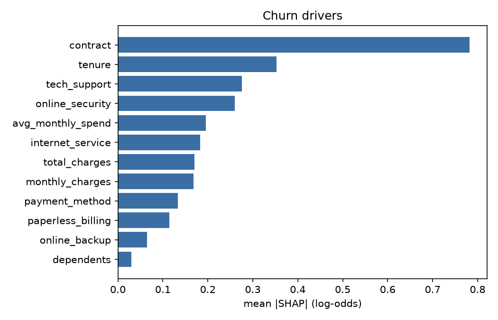
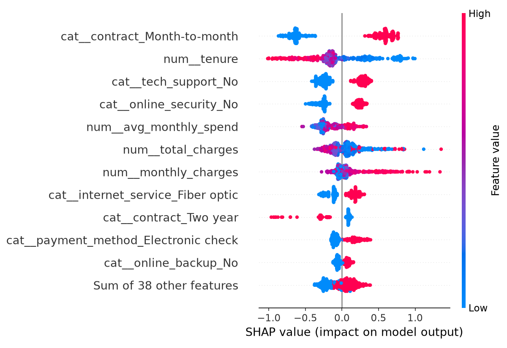

# Model card: churn-classifier v4

Generated by `churn model-card` from the champion's bundle.

## Summary

| | |
|---|---|
| Registry version | v4, alias `champion` |
| Algorithm | gradient_boosting + Platt calibration (sigmoid) |
| MLflow run | `f981c27f36a94f9897debf7ca08234c8` |
| Trained because | drift |
| Production cohorts used | 2026-01-01, 2026-02-01, 2026-03-01, 2026-05-01 |
| Training rows | 3,616 (hash `cdf7c1dd1d30`) |
| Promotion holdout | 1,409 customers (hash `76e585d34f2a`) |
| Parity, trained vs artifact | OK (905 rows, max diff 0.0) |

## Purpose and use

- **Goal:** rank active customers by their probability of cancelling, so the retention team knows who to make an offer to.
- **Decision:** contact if `p x 35% x CLV > $60` (expected value per customer).
- **Primary use:** monthly batch scoring of the customer base. The API serves single lookups.
- **Out of scope:** setting the offer amount, credit decisions, or treating a score as a certainty about an individual.

## Population and target

- **Universe:** all 7,043 customers in IBM Telco Customer Churn, no exclusions.
- **Target:** `churn = 1` if the customer cancelled within the observed period (`Churn = Yes`).
- **Label maturity:** 30 days after the snapshot.

| Sample | Rows | Churn | Hash |
|---|---|---|---|
| train | 2,816 | 26.5% | `e7612d2814d2` |
| test | 705 | 26.5% | `bfbc380e02ad` |
| holdout | 1,409 | 26.5% | `76e585d34f2a` |
| production_pool | 2,113 | 26.6% | `7b85a10ff963` |

## Performance

| Metric | Train | Test | Holdout |
|---|---|---|---|
| Gini | 0.780 | 0.705 | 0.672 |
| KS | 0.626 | 0.551 | 0.515 |
| ECE | 0.055 | 0.034 | 0.027 |
| Recall of the decision | 0.842 | 0.847 | 0.767 |
| Campaign net value | - | $48,921 | $62,363 |

5-fold CV on train: Gini 0.670 +- 0.036. Train-test gap: 0.075 Gini (max allowed 0.1).

### Decision policy (test)

| Rule | Net value |
|---|---|
| Expected value per customer | $48,921 |
| Best global threshold (0.15) | $47,039 |
| Default 0.5 | $30,895 |

Chosen rule: **expected_value**, contacting 46.4% of customers.

## Calibration (holdout, by score decile)

Test ECE before calibration: 0.028, after: 0.034.

|   decile |       n |   mean_predicted |   observed_rate |   abs_error |
|---------:|--------:|-----------------:|----------------:|------------:|
|    1.000 | 141.000 |            0.025 |           0.021 |       0.004 |
|    2.000 | 141.000 |            0.039 |           0.021 |       0.018 |
|    3.000 | 141.000 |            0.059 |           0.078 |       0.019 |
|    4.000 | 141.000 |            0.100 |           0.099 |       0.000 |
|    5.000 | 141.000 |            0.156 |           0.177 |       0.021 |
|    6.000 | 140.000 |            0.236 |           0.214 |       0.021 |
|    7.000 | 141.000 |            0.318 |           0.255 |       0.063 |
|    8.000 | 141.000 |            0.417 |           0.426 |       0.008 |
|    9.000 | 141.000 |            0.543 |           0.582 |       0.038 |
|   10.000 | 141.000 |            0.700 |           0.780 |       0.080 |

## Performance by driver (holdout)

| segment          | value                     |   n |   churn_rate |   mean_predicted |   gini |   recall |   contact_rate |
|:-----------------|:--------------------------|----:|-------------:|-----------------:|-------:|---------:|---------------:|
| contract         | Month-to-month            | 803 |        0.412 |            0.395 |  0.529 |    0.813 |          0.669 |
| contract         | One year                  | 293 |        0.106 |            0.112 |  0.352 |    0.452 |          0.222 |
| contract         | Two year                  | 313 |        0.038 |            0.050 |  0.403 |    0.333 |          0.067 |
| internet_service | DSL                       | 508 |        0.191 |            0.186 |  0.562 |    0.443 |          0.222 |
| internet_service | Fiber optic               | 610 |        0.410 |            0.397 |  0.611 |    0.976 |          0.836 |
| internet_service | No                        | 291 |        0.093 |            0.097 |  0.659 |    0.000 |          0.000 |
| tenure_band      | 0-6m                      | 311 |        0.524 |            0.465 |  0.527 |    0.779 |          0.633 |
| tenure_band      | 13-24m                    | 186 |        0.269 |            0.258 |  0.667 |    0.840 |          0.468 |
| tenure_band      | 25-48m                    | 305 |        0.197 |            0.204 |  0.505 |    0.700 |          0.413 |
| tenure_band      | 49m+                      | 441 |        0.100 |            0.114 |  0.524 |    0.636 |          0.277 |
| tenure_band      | 7-12m                     | 166 |        0.343 |            0.364 |  0.649 |    0.842 |          0.548 |
| payment_method   | Bank transfer (automatic) | 304 |        0.145 |            0.164 |  0.620 |    0.705 |          0.319 |
| payment_method   | Credit card (automatic)   | 311 |        0.170 |            0.166 |  0.578 |    0.566 |          0.286 |
| payment_method   | Electronic check          | 477 |        0.461 |            0.414 |  0.579 |    0.895 |          0.755 |
| payment_method   | Mailed check              | 317 |        0.180 |            0.209 |  0.670 |    0.509 |          0.243 |

**Weakest segments (discrimination):**

| segment     | value    |   n |   gini |
|:------------|:---------|----:|-------:|
| contract    | One year | 293 |  0.352 |
| contract    | Two year | 313 |  0.403 |
| tenure_band | 25-48m   | 305 |  0.505 |

**Largest calibration gaps:**

| segment        | value            |   n |   churn_rate |   mean_predicted |
|:---------------|:-----------------|----:|-------------:|-----------------:|
| tenure_band    | 0-6m             | 311 |        0.524 |            0.465 |
| payment_method | Electronic check | 477 |        0.461 |            0.414 |
| payment_method | Mailed check     | 317 |        0.180 |            0.209 |

## Drivers (SHAP)

| feature           |   mean_abs_shap |   share |
|:------------------|----------------:|--------:|
| contract          |           0.782 |   0.275 |
| tenure            |           0.352 |   0.124 |
| tech_support      |           0.276 |   0.097 |
| online_security   |           0.260 |   0.091 |
| avg_monthly_spend |           0.196 |   0.069 |
| internet_service  |           0.183 |   0.064 |
| total_charges     |           0.171 |   0.060 |
| monthly_charges   |           0.168 |   0.059 |
| payment_method    |           0.134 |   0.047 |
| paperless_billing |           0.114 |   0.040 |

## Sensitivity (+-1 std stress)

| feature         | shift            |   mean_score_base |   mean_score_stressed |   delta_score |   contact_rate_base |   contact_rate_stressed |
|:----------------|:-----------------|------------------:|----------------------:|--------------:|--------------------:|------------------------:|
| tenure          | -1 std (-24.4)   |             0.268 |                 0.326 |         0.058 |               0.464 |                   0.545 |
| tenure          | +1 std (+24.4)   |             0.268 |                 0.155 |        -0.113 |               0.464 |                   0.316 |
| monthly_charges | -1 std (-29.9)   |             0.268 |                 0.222 |        -0.046 |               0.464 |                   0.288 |
| monthly_charges | +1 std (+29.9)   |             0.268 |                 0.287 |         0.019 |               0.464 |                   0.591 |
| total_charges   | -1 std (-2273.6) |             0.268 |                 0.288 |         0.021 |               0.464 |                   0.466 |
| total_charges   | +1 std (+2273.6) |             0.268 |                 0.242 |        -0.026 |               0.464 |                   0.481 |

- `tenure` is the dominant numeric driver in both directions.
- Under the expected-value rule, `monthly_charges` moves the contact rate more than the score, because it also changes the customer's value (CLV = charge x 12).
- `total_charges` is roughly `tenure x monthly_charges`. Stressing it alone creates customers that can't exist (it breaks `avg_monthly_spend`), which is why its response is not monotonic. Don't read it as a business scenario.

## Limitations

- **Static data, simulated time.** Telco has no dates, so there is no real out-of-time sample. The simulated monthly cohorts act as a pseudo-OOT.
- **Simplified customer value.** CLV is monthly charge x 12; no discounting and no churn risk after retention.
- **Fixed offer acceptance rate (35%).** In practice it depends on the segment and should come from a retention experiment with a control group.
- **Small promotion margins.** Value differences between versions on the holdout are within sampling noise; the promotion rule has no significance test.
- **Global calibration.** Platt fixes the average level; individual segments (see the driver table) can stay biased.
- **Fixed holdout.** It reflects the original population and should be refreshed (versioned) from recent matured labels after a lasting shift.

## Monitoring plan

| Control | Frequency | Threshold | Action |
|---|---|---|---|
| Schema and range validation (Pandera) | every batch | any failure | quarantine the batch |
| PSI per feature and on the score | every batch | >= 0.25 | retraining signal |
| Realized Gini on matured cohorts (95% CI) | monthly | upper bound < 0.6 | retraining signal |
| Predicted vs actual churn rate | monthly | - | review calibration |
| Challenger promotion | per retrain | more value and Gini >= champion - 0.01 | move the `champion` alias |
